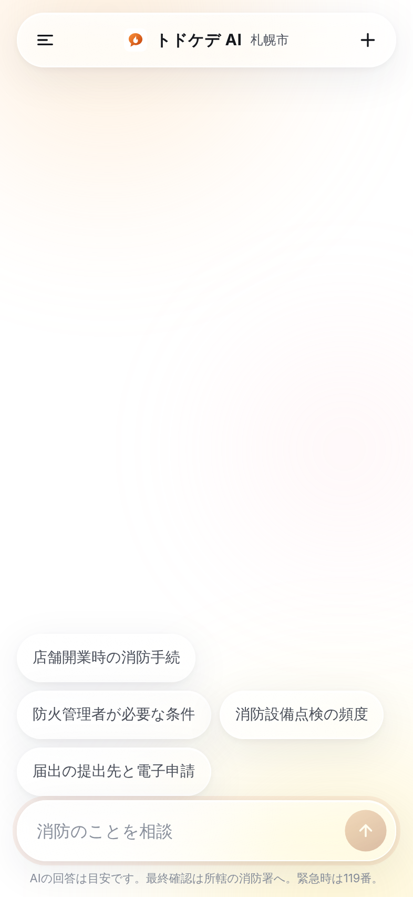
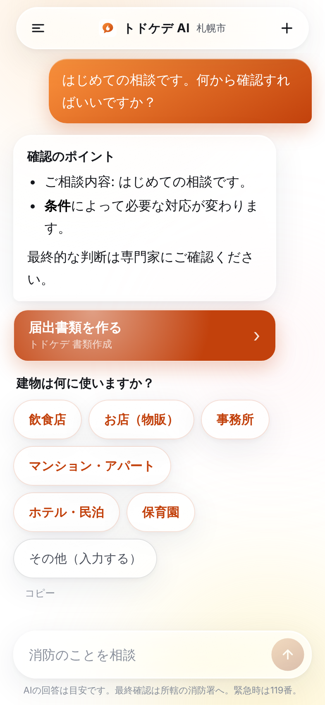
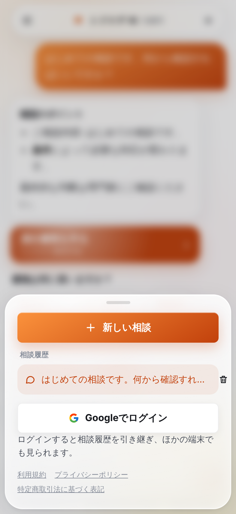
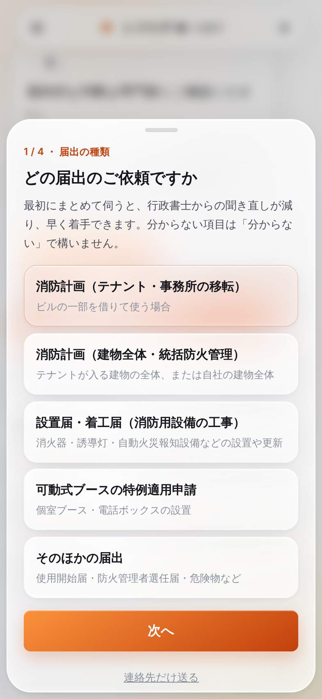
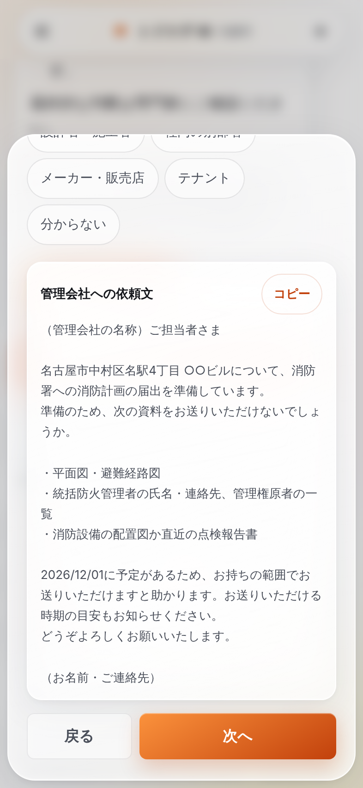

# デザイン基準

東京の消防相談で確立した見た目と動きを、すべてのサービスで同じにするための基準。数値は `src/client/styles.css` と `index.html` にあり、ここはその意図と使い方を書く。値を変えるときは、このファイルとスクリーンショットも更新する。

| スケルトン | 最初の画面 | 回答 | メニュー |
|---|---|---|---|
|  |  |  |  |

| ヒアリング（届出の種類） | ヒアリング（資料と依頼文） |
|---|---|
|  |  |

行政書士に依頼する前に、届出の種類ごとの項目を1つのシートで順に聞く（`src/hearing/hearing.ts`）。選ぶ項目はチップ、資料は持ち主をチップで選び、顧客以外が持つ資料にはその相手への依頼文をその場で出す。

相談は無料になったため、課金シート（旧 `5-paywall.png`）はなくなりました。

`pnpm screenshots` で撮り直せる（幅393px・2倍）。

## 原則

1. **入力欄が主役。** 最初の画面は、ヘッダー（メニュー・名前・新規）、質問の候補、入力欄、注意書き1行だけ。何をするサービスかは、名前と候補とプレースホルダーで伝わるようにする。
2. **白とガラス。** 背景は白一色の上に、淡い色の光が3つゆっくり動く。その上の面はすべて半透明のガラス。影は薄く、線はほぼ見えない。
3. **動きで手触りを出す。** 押すと縮み、出るときは少し行き過ぎて戻る（スプリング）。待ち時間はスケルトンと点滅するカーソルで埋め、画面が止まって見える時間を作らない。
4. **色は1つ。** サービスの色（accent）は、送信ボタン・利用者の吹き出し・強調・フォーカスの輪だけに使う。

## トークン

### 色

| トークン | 値 | 用途 |
|---|---|---|
| `--bg` | `#ffffff` | 背景（変えない） |
| `--ink` / `--ink-2` / `--ink-3` | `#15171c` / `#4a4f5a` / `#8a909c` | 本文 / 補足 / プレースホルダー・注記 |
| `--accent` / `--accent-2` | `service.ts` の `theme` | 主色 / グラデーションの始点 |
| `--accent-soft` / `--accent-line` / `--accent-glow` | accent の 8% / 16% / 26% | バッジ背景・選択中の行 / バッジの線 / 影 |
| `--amb-1..3` | `service.ts` の `theme.ambient` | 背景で動く光 |
| `--line` | `rgba(20,24,33,.08)` | 区切り線 |

accent は白背景でコントラスト比 4.5 以上（単体テストが検査する）。

### ガラス（`.glass`）

- 面: `linear-gradient(160deg, rgba(255,255,255,.7), rgba(255,255,255,.38))`
- ぼかし: `backdrop-filter: blur(22px) saturate(180%)`（`-webkit-` も併記）
- 縁: `1px solid rgba(255,255,255,.85)`
- 影: 内側の上端ハイライト、下端の弱い反射、内側の白い霞、外側の柔らかい影の4層
- 光: `::before` がポインタの位置（`--mx` `--my`）に追従する放射グラデーション
- 送信時の光沢: `.shine` を付けると `::after` が左から右へ流れる

新しい面（カード・シート・トースト・チップ）は必ず `.glass` を付ける。白の不透明な面は、ボタン（`.btn-google`）とスケルトンだけ。

### 形と大きさ

| 要素 | 値 |
|---|---|
| ヘッダー | 高さ52px、角丸26px、上と左右に16px（セーフエリア優先） |
| 入力欄 | 角丸28px、最小高さ44px、最大168px まで自動で伸びる、文字16px（iOS の拡大を防ぐ） |
| 送信ボタン | 44px の円 |
| 吹き出し | 角丸22px、話者側の下の角だけ8px |
| シート | 画面下から、左右8px、角丸30px、最大高さ82dvh、下にスワイプで閉じる |
| ボタン | 高さ50px以上、角丸8px |
| 本文の幅 | 最大720px で中央寄せ |

### 動き

| 名前 | 値 | 使う場面 |
|---|---|---|
| `--spring` | `cubic-bezier(.34,1.56,.64,1)` | 出現・押下からの戻り・シート |
| `--ease-out` | `cubic-bezier(.22,1,.36,1)` | 退場・画面全体の表示 |
| `appIn` | 0.6s、0.985倍から | アプリ全体の初回表示 |
| `msgIn` | 0.55s、下から14px・0.94倍・ぼかし6px から | メッセージの出現 |
| `chipIn` | 0.6s、候補ごとに0.06s ずらす | 候補・シート内の要素（`.stagger`） |
| `sheetIn` / `sheetOut` | 0.6s / 0.3s | シート |
| `drift` | 26〜38s、往復 | 背景の光 |
| リップル | 0.6s | `.rp` の付いたボタンの押下位置 |
| View Transitions | 0.35s | 新しい相談・履歴を開くときの切り替え |

`prefers-reduced-motion: reduce` ではすべて止める（`styles.css` の末尾とスケルトン）。

## スケルトン

- `index.html` の `#boot` に直接書く。CSS も `index.html` の `<style>` に入れ、JS や外部 CSS の読み込みを待たずに出す。
- ヘッダー・吹き出し4つ・入力欄の形を、実際の画面と同じ位置と角丸で描く。
- アプリの描画後に `opacity` と `blur` で0.45秒かけて消す。
- 10秒たっても画面が出ないときは再読み込みボタンを出す。
- 履歴を開くとき・メニューの履歴を読むときも、同じ見た目のスケルトンを出す。

## 文言

- 画面の文言は、です・ます調で短く。主語や理由の説明は省いてよい。
- 感嘆符・絵文字・「さあ」「今すぐ」のような呼びかけは使わない。
- エラーは「何が起きたか」と「どうすればいいか」を1文で（例: 送信に失敗しました。時間をおいてもう一度お試しください。）。
- 価格を画面に出すときは「月額○○円（税込）」の形で、税込を必ず書く。相談の画面には価格を出さない（相談は無料）。
